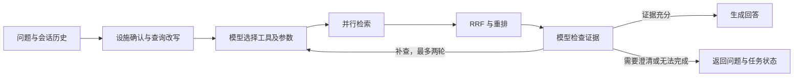

# 电力设施智能检索平台

面向电力设施技术文档、图纸图片和三维场景的检索问答服务。系统将文档知识与场景业务数据接入同一条查询链路，支持多路检索、证据检查、流式回答和任务恢复。

我主要参与问答链路、多模态知识库和 Java 接口联调。本仓库集中展示 Python 侧的文档导入、检索编排及任务管理；三维场景数据通过外部 Java 服务获取。

## 业务与实现

技术资料查询经常同时包含设备型号、专业术语和自然语言描述，单一路径容易漏掉相关内容。检索层保留语义、关键词和查询扩展三类能力，由模型按问题选择工具；涉及场景状态或外部信息时，再调用对应业务接口或联网工具。

| 环节 | 实现 | 设计考虑 |
| --- | --- | --- |
| 文档处理 | MinerU 解析 PDF，视觉模型描述图片，MinIO 保存原图 | 将文字和图片说明纳入可检索内容，保留原图入口 |
| 文档组织 | 父子分块，子块召回后回取父块 | 在匹配粒度与上下文完整性之间取舍 |
| 多路检索 | BGE-M3、SQLite FTS5 BM25、HyDE | 分别处理语义匹配、型号术语和表达差异 |
| 结果融合 | RRF 融合，重排接口评分，动态截断 | 先按排名融合，避免直接比较不同检索器的分数 |
| 查询决策 | LangGraph 编排，模型选择工具并检查检索证据 | 根据实际结果补查、追问或结束，最多两轮 |
| 任务恢复 | SQLite Checkpoint 与持久事件日志 | 分开处理节点恢复和客户端断线补发 |

## 查询流程



每轮记录工具查询参数、返回内容摘要和后续决策。并行节点只提交本节点更新的字段；BM25 与向量检索使用相同的父块标识，保证同一文档能够参与融合去重。具体说明见 [查询设计](docs/standards/query-decisions.md)。

## 快速开始

环境：Python 3.12、uv。在仓库根目录执行：

```powershell
uv sync --locked
uv run python -m evaluation.demo
uv run pytest -q
```

本地示例使用合成资料，执行真实的 BM25 入库、检索和父块返回，无需配置模型或外部数据库。输入位于 `examples/demo-documents.json`，已归档输出位于 `examples/demo-output.json`。该入口用于检查本地检索链路；完整模型问答需要以下服务配置。

## 启动完整服务

```powershell
Copy-Item .env.example .env
```

按 [运行说明](docs/standards/running.md) 配置模型、Milvus、MongoDB 和对象存储等依赖，再分别在两个终端启动：

```powershell
uv run uvicorn web.api.import_service:app --host 127.0.0.1 --port 8002
uv run uvicorn web.api.query_service:app --host 127.0.0.1 --port 8003
```

- 文档导入页面：`http://127.0.0.1:8002`
- 查询页面：`http://127.0.0.1:8003`

内置页面用于本地演示。启用 `AGENT_API_KEY` 后，通过支持鉴权请求头的 API 客户端调用。

## 接口与任务状态

| 接口 | 用途 |
| --- | --- |
| `POST /query` | 提交问题；`is_stream=true` 返回任务 ID |
| `GET /stream/{task_id}` | 接收流式回答，支持 `Last-Event-ID` 重放 |
| `GET /tasks/{task_id}` | 查看执行状态、结果及决策记录 |
| `POST /tasks/{task_id}/resume` | 恢复失败或中断任务 |

执行状态与回答状态分开表示：`status` 描述任务执行，`result_status` 描述证据判断，包括 `answered`、`needs_clarification`、`insufficient_evidence` 和 `incomplete`。非流式执行失败返回 HTTP 502，空答案记为失败。

SSE 的 `ready.reset=true` 表示开始生成新一轮答案，客户端清空旧的部分文本；`final.answer` 为最终完整答案。各订阅者使用独立游标读取事件，避免多页面连接相互消费消息。

## 测试与评测

当前归档回归结果为 **31 项通过，0 失败、0 跳过**。测试覆盖工具参数传递、并行状态合并、检索补查及上限、接口失败、SSE 多订阅和检查点恢复。报告见 `examples/tests.xml`。

真实检索评测使用人工标注数据集：

```powershell
uv run python -m evaluation.live_rag_eval evaluation/golden.jsonl --k 10 --output evaluation/result.jsonl
uv run python -m evaluation.rag_evaluator evaluation/result.jsonl --k 10
```

仓库提供数据格式和执行脚本；企业标注集与逐题结果未包含在公开版本中。指标定义、测试范围和复现要求见 [评测说明](docs/evaluation.md)。

## 部署范围

当前采用单 worker 服务和本地 SQLite 持久化。检查点支持节点级恢复，外部调用仍可能重试；多 worker 任务协调、用户级数据隔离及逐句引用校验尚未实现。`/ready` 只检查状态库。完整企业环境、负载与真实模型质量需要独立验收。

## 文档索引

- [运行与依赖配置](docs/standards/running.md)
- [查询决策与设计取舍](docs/standards/query-decisions.md)
- [测试和评测口径](docs/evaluation.md)
- [可靠性修复记录](docs/fix/query-reliability.md)
- [版本验证与维护记录](docs/plans/query-reliability-progress.md)
